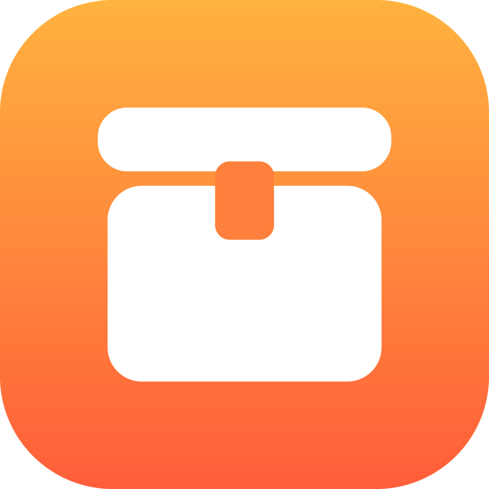
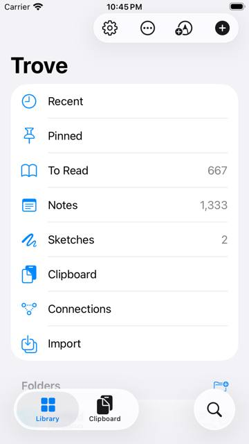
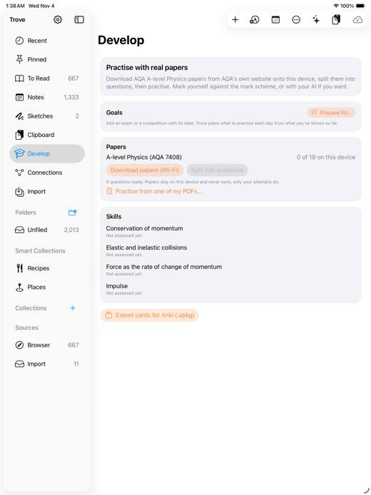

<p align="center">
  
</p>

<h1 align="center">Trove</h1>

<p align="center">
  <b>Save anything. Find it by meaning. Practise for your exams.</b><br>
  A native second brain and notes app for Mac, iPhone and iPad. It syncs through your own iCloud Drive and is end-to-end encrypted.
</p>

<p align="center">
  <a href="https://github.com/mrlancus/trove/actions/workflows/tests.yml"></a>
  <a href="https://github.com/mrlancus/trove/actions/workflows/apps.yml"></a>
  <a href="https://github.com/mrlancus/trove/actions/workflows/catalogue.yml"></a>
  
  
</p>

<p align="center">
  
  &nbsp;
  
</p>

## What it does

- **Capture from anywhere.** Links, screenshots, photos, PDFs, voice notes, web highlights, email,
  handwriting. Use the share sheet, widgets, the Safari and Chrome extensions, or forward an email.
- **It organises itself.** Trove reads the text in images and PDFs, pulls out dates, places, prices and
  recipes, and tags and summarises what you save. Most of this runs on Apple's on-device frameworks
  (Vision, NaturalLanguage, Speech), so it works on devices without Apple Intelligence. Where Apple
  Intelligence is available, Foundation Models adds more.
- **Search by meaning.** "Blue chair" finds the photo of the blue chair. Semantic search runs on the
  device.
- **A real notes app.** Markdown notes, wikilinks, Apple Pencil notebooks and sketches.
- **Works with what you already use.** Import from, or mirror to, Apple Notes, Obsidian, Notion, Kindle,
  Readwise and GoodNotes.
- **Develop: practise with real past papers.** Choose your courses (GCSE, IGCSE, AS/A-level, from AQA,
  OCR, Pearson Edexcel, Eduqas, WJEC and Cambridge) and Trove downloads the board's papers onto your
  device and splits them into questions. You mark yourself against the mark scheme, or ask your AI to
  mark. Goals plan what to practise each day, and mastery is tracked per skill. You can export cards to
  Anki.
- **Private by design.** Everything is end-to-end encrypted. Sync uses your own iCloud Drive for free,
  with an optional Cloudflare relay you run for instant sync. The relay can never read your data.

## How it fits together

| Folder | What |
|---|---|
| [`App/`](App) | SwiftUI apps for macOS, iOS and iPadOS, plus a share extension, widgets and a Safari extension (XcodeGen project) |
| [`Packages/TroveCore/`](Packages/TroveCore) | Shared Swift core: sync engine, encryption, merge, importers, search, Develop. Tested on Linux and Apple platforms |
| [`server/`](server) | Cloudflare Worker relay: instant sync, sealed inbox, GoodNotes WebDAV, email-in, opt-in AI |
| [`web/`](web) | Trove in any browser, served by the relay (browse, search, write, upload; end-to-end encrypted) |
| [`extensions/browser/`](extensions/browser) | "Save to Trove" for Chrome (and Safari) |
| [`mcp/`](mcp) | `trove-mcp`, so Claude Desktop and Claude Code can search and add to your Trove |
| [`catalogue/`](catalogue) | Past-paper links from the exam boards' own sites, rebuilt weekly ([how](docs/CATALOGUE.md)) |

```
  Mac · iPhone · iPad (SwiftUI)        Browser (web/)        Claude (mcp/)
              │                              │                     │
              └──────────── TroveCore / its JS port ───────────────┘
                                   │  same encrypted bytes (docs/PROTOCOL.md)
             iCloud Drive/Trove/ ──┴── Cloudflare relay (optional)
```

## Get the apps

GitHub Actions builds the apps on every push to `main`, and the latest build is always at the same links:

- **Mac:** [Trove-macOS.zip](https://github.com/mrlancus/trove/releases/download/latest/Trove-macOS.zip).
  Unzip it, then right-click Trove.app and choose Open (the app isn't notarised). After that it updates
  itself.
- **iPhone and iPad:** [Trove.ipa](https://github.com/mrlancus/trove/releases/download/latest/Trove.ipa).
  Install it with Sideloadly or SideStore using a free Apple ID, and reinstall every 7 days.

## Build and test

```bash
./scripts/test-all.sh                     # relay + TroveCore + extension tests
cd App && xcodegen                        # (brew install xcodegen) → Trove.xcodeproj
xcodebuild -project App/Trove.xcodeproj -scheme Trove -destination 'platform=macOS' build
cd web && npm test                        # web core + Swift interop fixtures
python3 scripts/catalogue/build.py        # rebuild the past-paper catalogue
```

## Docs

- [NOTES.md](NOTES.md): status, what's next, and manual steps
- [docs/RESEARCH.md](docs/RESEARCH.md): the product spec and its constraints
- [docs/ARCHITECTURE.md](docs/ARCHITECTURE.md): the code map
- [docs/PROTOCOL.md](docs/PROTOCOL.md): the byte-level contract shared by Swift, the Worker and the web app
- [docs/CATALOGUE.md](docs/CATALOGUE.md): how the past-paper catalogue is built
- [docs/MASTER_PLAN.md](docs/MASTER_PLAN.md) and [docs/DEVELOP_PLAN.md](docs/DEVELOP_PLAN.md): what's being built next

Past papers belong to their exam boards. Trove stores links and facts only, and each device downloads
papers directly from the board's own website.
