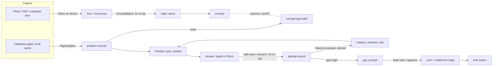

# Develop: analysis, architecture and roadmap

_Written 2026-11-03 from `docs/prompts/develop-perf-testing.md` Part 1, after reading the code at
`main` 678ea6c. The code is the source of truth; where this plan and the code disagree, the code wins
and this plan gets fixed._

**Capture anything. Connect everything. Understand more. Develop real abilities.** Develop is the
fourth pillar: practice, assessment, spaced practice of *skills* (not only facts), mastery you can
explain, and preparation for a goal. It extends what Trove already has: records and ops, the link
graph, FSRS cards, Ask, handwriting and Math Assist. It doesn't run alongside them.

Reading guide: §A–§F take about 40 minutes. The appendices hold the protocol draft, the maths, the
cost workings and the copyright research.

---

## A. What exists (only what Develop builds on)

`docs/ARCHITECTURE.md` describes the layers correctly. Here is what Develop depends on, checked in
the code.

### A1. Data model and sync
- **Records from ops.** `RecordStore` (`Packages/TroveCore/Sources/TroveCore/Sync/RecordStore.swift`)
  materialises records from ops sorted by HLC. `set` ops carry **only the fields they change**
  (`SyncEngine.set(_:record:kind:)`), so each field is last-writer-wins on its own. `text` ops merge
  with diff3 (`TextMerge.swift`) and keep conflict copies in `_conflicts`.
- **Record kinds in use**: `item`, `collection`, `folder`, `clip`, `stroke`, `element`, `setting`,
  `card`, `aiChat`, `aiusage` (per device per day), plus bridge kinds on the relay. `RecordStore`
  indexes records by kind (`byKind`, `visible(kind:)`), and the change feed (`changes(since:)`,
  `ChangeSet.byKind`) says which ids of which kinds changed. A new kind gets both for free.
- **Unknown data is kept.** An older client never rewrites a whole record: it sends ops with only the
  fields it edits, so a field it doesn't know survives its writes. It ignores a kind it doesn't
  know, because every list is built from `records(kind:)` for kinds it does know. Checkpoints
  (`Checkpoint.swift`, `web/public/core/checkpoint.js`) carry every record of every kind. The
  website's journal (`web/public/core/vault.js` `set`) works the same way. One real limit: a field
  holding an **array** (for example `links`) is one LWW value, so two devices adding to it at once
  keep only one device's list. Develop must not store its edges that way (§C2).
- **Segments and encryption**: TRV1 AES-256-GCM segments over iCloud Drive (`FolderTransport`) and
  the relay (`RelayClient`, `segments/batch`). The local copy is SQLite (`LocalDatabase.swift`,
  CSQLite on Linux), not JSON. `ARCHITECTURE.md` still says JSON; fixed in a separate commit.
- **JS port**: `web/public/core/records.js`, `merge.js`, `vault.js`. It's kept in step by the
  fixtures in `Packages/TroveCore/Tests/TroveCoreTests/Fixtures` and `WebInteropTests.swift`.

### A2. The graph today
- `[[wikilinks]]` plus hand-made `links` (an array field on the item). `Links.graph`
  (`Model/Links.swift`) rebuilds outgoing, incoming and unresolved links from every item's body. It
  runs off the main thread in the app (`AppModel.reload`), but it's O(all items) on each run.
- Folders and auto-filing (`Organizer.swift`, `kind: "folder"` records), collections, `kind` (what
  an item is) and `category` (what it's about). "Maybe related" comes from `SemanticIndex`
  (NLEmbedding, on the device) and keywords (`KeywordCache`, `AIResearch.swift`).
- **No typed edges, no edge records, no concept objects.** Every link is "related", with no direction
  that means anything and no "rejected" state.

### A3. Study
- `Model/Study.swift`: FSRS-5 with the default weights, `card.<note>.<sha12(front)>` records holding
  `stability`, `difficulty`, `reps`, `lapses`, `last`, `due` and `note`. Cards come from a note's
  `flashcards` field (`[{front, back}]`), made by Ask AI → Make flashcards or the notebook chat.
  `studyQueue` allows 20 new cards a day. The UI is `App/Sources/Views/StudyView.swift`, a sheet
  opened from an item's menu (⇧⌘Y).
- No review log. A card's history is its op history (each review is a `set` op), which nothing
  reads yet.

### A4. Handwriting and maths
- Vision recognition in the app (`App/Sources/Drawing/Handwriting.swift`), with page line boxes
  stored in `HandwritingPages` and a per-page cache. It stores **no confidence** per line. Only
  Math Assist (`MathAssistController.swift`, `TroveCore/Math`) keeps Vision's candidates with their
  confidences.
- Math Assist: `MathExpression` (parser and solver), `EqualsDetector`, `MathCandidates`, `MathCache`.
  Everything runs on the device.
- PDF marks (`Drawing/PDFMarks.swift`): text for search, highlights, forms. GoodNotes import and
  export (`Import/GoodNotesInk.swift`, `GoodNotesWriter.swift`).

### A5. AI: every call site
Provider order in the apps: your own key (`AIProvider.swift`, `settings.ai`), then Apple Intelligence
(`OnDeviceAI.swift`, the iPad only), then the relay (`server/src/ai.ts`).

| Call site | Trigger | Route | Model and effort | Max output | Caching |
|---|---|---|---|---|---|
| Ask (`AIResearch.research`, `AppModel+OwnAI.swift:121`) | User asks | Own key | Tier picked (Fast/Smarter/Best), medium | 8,000 | Automatic (`cache_control` at the top level, `AIResearch.swift:641`) |
| Ask fallback (`AppModel.swift:1568–1577`) | Ask with no own key | Apple Intelligence, else relay `/ai/ask` | On-device / relay model, low | 8,000 | None |
| Notebook chat (`StudyChat.studyReply`, `StudyPanel.swift:112`) | User asks in a notebook | Own key | Fast, low | 700 + 1,500 | Explicit breakpoint on the notebook, plus automatic |
| Session summary, diagram tweak (`StudyChat.swift:327, 339`) | Closing a chat, Tweak | Own key | Fast, low | 1,200 / 1,500 | None |
| Note actions (`AppModel+OwnAI.swift:77, 89`; `AppModel+AI.swift:95, 130`) | User picks an action | Own key, else relay `/ai/action` | Fast, low | 4,000 | None |
| Reading handwriting (`Handwriting.swift:60, 216`, `AIProvider.readPage`) | New pages (live) or Read all | Own key | Fast, low | 6,000 | None |
| Enrichment (`EnrichmentService.swift:201, 262`) | Saved items, background | Relay `/ai/enrich` | Relay model, low | 8,000 | None |
| Keywords (`AIKeywords.improveKeywords`) | Settings, background | Own key | Fast, low | 4,000 + 400 per item | None |
| Test (`SettingsView.swift:493`) | Settings → Test | Own key | Fast | 1,000 | None |
| Website (`web/public/ai.js`, `aiactions.js`) | User | Relay `/ai/*` | Relay model | relay limits | None |

The relay defaults to `claude-haiku-5-5` (`server/src/ai.ts` `DEFAULT_MODEL`) with 1,000,000 tokens
per vault per month (`DEFAULT_MONTHLY_TOKENS`), counting cache reads at full weight. Every own-key
request is metered into `aiusage` records (`Enrich/AIUsage.swift`) and shown in
`App/Sources/Views/AIActivityView.swift`.

**Correction to the prompt's Facts:** it says there's no prompt caching anywhere. The code has it
on the two biggest call sites (Ask tools and the notebook chat), but not in the relay and not in
`AIProvider.complete`. Recorded in `docs/PERF_AUDIT.md` §4.

### A6. Docs that were wrong (fixed in a separate commit)
1. `ARCHITECTURE.md` "Sync": the local copy is SQLite (`LocalDatabase.swift`), not a JSON snapshot.
2. `ARCHITECTURE.md` "Data model": the record kinds are many more than `item` and `collection`.
3. `ARCHITECTURE.md` AI table: Ask in the apps is tool-based (`AIResearch.swift`), not "local search
   → best ~20 snippets", which is the website only. Also missing: `StudyChat.swift`, `AIUsage.swift`,
   `AIKeywords.swift`.
4. `NOTES.md` "Decisions made so far": the relay's default model is Haiku 5.5, not Opus 5.5.

---

## B. Critical analysis

### B1. What's what
| | Parts |
|---|---|
| **Exists and is reused as is** | Records, ops, change feed, TRV1, checkpoints; items as sources (photos, PDFs, notebooks); FSRS-5 maths; Math Assist; Vision with line boxes; `AIUsage` metering; Ask tools; AI providers and tiers; `KeywordCache` and `Tokenizer` (concept matching) |
| **Extends** | FSRS gets a second user (skills); `flashcards` gets a source edge; `AIUsage.Purpose` gets `develop`; Handwriting gets per-line confidence; the AI activity window gets cost per marked question |
| **Needs redesign** | Hand-made `links` (an array, so concurrent adds lose); "Maybe related" (no way to say no and have it stick) |
| **New** | Concepts and skills, typed edges, problems, attempts (evidence), curriculum specs, the paper catalogue, the mastery engine, skill scheduling, the practice loop, Anki export, campaigns |

### B2. Conflicts, risks and what's over-complicated
- **AI marking of handwriting vs decision 9** ("handwriting and maths AI on the device; cloud only
  through lasso → Ask"). Resolved (F5): *reading* handwriting stays on the device; **Mark with AI is
  an explicit tap like lasso → Ask**, and only then is a crop of the answer area sent. Nothing about
  Develop sends handwriting in the background.
- **"Saves it all as items in my vault" vs "no PDFs in the relay or R2" vs AQA's "must not be
  reproduced on third party websites – in any format".** My vault's segments and blobs live in R2
  (encrypted). A downloaded board paper stored as an attachment would be a copy in R2. So
  (F3) **catalogue papers stay in a local cache on each device and never sync**; the vault keeps only
  facts and references (which document, page, region, marks, concepts) and my own attempts. Each
  device downloads the paper from the board itself. My own uploads sync like any other item.
- **Risk: the mastery model is wrong for me.** With five attempts per skill nothing fits parameters.
  The model is deliberately simple (B3, point 3), every constant is named in one file, and its
  predictions are logged so we can see whether they're right (calibration, §C7).
- **Risk: splitting papers is fiddly.** Exam PDFs are typeset consistently per board. The first
  slice does one board (AQA) and one paper layout, with a manual fix-up view. Scans come later.
- **Over-complicated in the prompt, cut or postponed:** four separate object families (Knowledge,
  Sources, Activities, Evidence) as four record kinds each with sub-kinds; skill trees; XP;
  readiness percentages before there's evidence; campaigns before the loop works; assessment
  methods for music, CAD and speaking (the interface is designed, nothing more).

### B3. Positions on the twelve questions

**1. The graph's shape.** Not four object types. Items already are Sources. Add **three record
kinds for knowledge and activity** (`concept`, `problem`, `attempt`) plus **one edge kind**
(`edge`), and two for curriculum (`spec`) and goals (`campaign`, later). An edge is its own record
with a **deterministic id** `edge.<sha12(from \n type \n to)>`, so two devices adding the same link
offline produce the same record and the merge is free. Changing an edge's state (suggested →
accepted → rejected) is a per-field LWW `set`, so the newest decision wins, and a rejection is a
record that stays: the suggester checks for it and never suggests that edge again. Fields on the
records they join (like `links`) were rejected because an array field loses concurrent adds and
can't hold a state or provenance per link. Traversal uses an `EdgeIndex` (from → edges, to → edges,
by type) kept up to date from the change feed for kind `edge` (O(changed), like the search index).
Both directions come from one record, so they can't disagree. Existing `links` and wikilinks stay
as they are and appear in the index as type `related`, read-only, so nothing is migrated.

**2. Concept identity.** Concepts are made by AI suggestions (accepted by me, or created when I
accept a link to them), by a specification's topic list on my device, or by hand. The id is
`concept.<slug>`, where the slug is the name lowercased, accent-folded, with punctuation removed and
spaces turned into `-`. Two devices creating "Conservation of momentum" offline therefore make the
same record. Near-duplicates ("momentum conservation") are found by `ConceptMatch`, which compares
the sets of stemmed content words (`Tokenizer.terms`, the search index's own) and, failing that,
uses a token Jaccard ≥ 0.8. An exact word-set match merges by itself, a near match is suggested.
A merge sets `mergedInto: <winner>` on the loser. The winner is the lexicographically smaller id, so
every device picks the same one. Edges aren't rewritten: the index resolves `mergedInto` chains when
it reads them, so links pointing at the loser show on the winner, and undoing a merge (clearing
`mergedInto`) restores everything. A curriculum's concept **is** my concept: specs reference concept
ids, they don't copy them. When a source is edited, its edges stay, and suggestions are re-run only
for what changed (content hash). When a source is deleted, its edges are hidden (an endpoint is
deleted), not deleted, so Restore brings them back. Attempts keep their own copy of what matters
(score, marks, difficulty, the problem's label), so evidence survives a deleted problem.

**3. The mastery model.** Compared:
| Option | Good | Bad with one user's data |
|---|---|---|
| FSRS per skill, modified | Already in Trove, handles time | Fits recall of one fact; ignores difficulty and hints |
| Bayesian Knowledge Tracing | Classic for skills | Four parameters per skill that five attempts can't fit; no time decay |
| Elo/IRT (1PL) | Difficulty built in; easy wins teach little by construction | No forgetting |
| **Hybrid: 1PL ability with an information-weighted step, plus FSRS for retention** | Each part does one job; farming can't work; every constant explainable | Two numbers to explain |

**Recommended: the hybrid, derived from evidence records, never stored.** Per skill:
- **Ability θ** (logit scale; 0 = an average candidate on a standard question at the spec's level).
  Each attempt with marking weight `wₘ`, independence-adjusted score `s` and problem difficulty `b`:
  `p = σ(θ − b)`, `K = K₀ / √(1 + n)`, `θ ← θ + K·wₘ·(s − p)`, `n ← n + wₘ·4p(1−p)`. Here `n` is the
  Fisher information gathered so far (a Bernoulli on the logit scale gives `p(1−p)`; ×4 makes a
  50/50 problem worth exactly 1), so steps shrink as evidence builds, and a problem I was sure to
  get right adds almost no information.
- **Two anti-farming rules.** A problem with `b < θ − 1` is **trivial for me**: it's recorded (it
  counts for consistency) but changes neither θ nor retention. And a success can't lift θ above
  `b + 1`: solving problems at difficulty *b* is evidence of ability around *b*, not above it.
- **Retention**: the existing `FSRS.review` on a per-skill state, with the grade from the attempt
  (`s ≥ 0.85` Good, `≥ 0.5` Hard, else Again). The chance I can apply the skill after *t* days is
  `P(t) = σ(θ − b_ref) · R(t)`, where `R` is FSRS's retrievability and `b_ref` the spec level's
  standard difficulty (0).
- **Scheduling**: practise again when `R` falls to **0.85** (`skillRetention`; lower than cards' 0.9
  because a practice problem costs minutes, not seconds). After a failure followed by reading the
  solution (hint level 5), reassess in **1 day** whatever R says.
- **Proficient** is a rule over evidence, separate from θ: mastery `σ(θ) ≥ 0.7` **and** at least
  three successes (`s ≥ 0.7`) on at least two different problems from at least two different
  sources, **and** the latest non-trivial attempt wasn't a failure. One success never makes it.
- **Repeated failure after a delay** (two failures on a skill at least a day after its last success)
  marks the skill's `requires` prerequisites for a look.
- **Priors and cold start.** θ₀ = 0, n₀ = 0, shown as "not assessed" until the first non-trivial
  attempt. Problem difficulty `b`, in order: the examiner report's national average for the
  question, when known (`b = −logit(average fraction of marks)`); else the level's base (GCSE −1,
  A-level 0, competition and university +1.5); later my own results across problems (a problem
  most attempts fail gets its `b` raised by the same 1PL step, once there are five attempts).
- **Noticing that it's wrong.** Every non-trivial attempt logs the `p` it predicted. The Develop
  view shows calibration once there are 30 attempts (predicted vs actual success in five bins). A
  Brier score worse than always guessing 0.5 says the model is wrong, and the constants file says
  what to change.
- **Derived, not stored.** Mastery, retention and the schedule are computed on each device from the
  `attempt` records (sorted by time, then id) by a pure function, `Mastery.evaluate`. Nothing to
  conflict in sync, and changing a constant re-scores all history consistently.

The three worked examples (exact inputs and outputs, also Part 3's test values) are in Appendix B.

**4. Problems from papers and uploads.** The split runs on the device. TroveCore `PaperSplitter`
works on positioned text lines (PDFKit on Apple, pdf.js text on the website, Vision for scans,
since `HandwritingPages` already stores line boxes):
1. Find question starts: a line beginning with a question number at the left margin (`^\d{1,2}
   (\.\d)*` or `\d+ \(a\)`) and nothing to its left, in reading order. AQA prints `0 1 . 1` with
   spaces; patterns are per board in the catalogue's `layout` field, not in code.
2. Find marks: `[3 marks]`, `(3)`, `[3]`, right-aligned, attributed to the part above them.
3. A question's region is from its start to the next start (across pages), so **diagrams come along
   as part of the original page**: the problem stores page rects, never re-drawn figures.
4. Multi-part questions are a tree: `4` → `4.1`, `4.2`, keyed `4.2`. A part's stem includes its
   parent's text by reference (the parent's rect), so "4.2" can be shown with "4" above it.
5. Mark schemes are split by the same question keys and matched by key. A part with no match shows
   "No mark scheme entry found" and marking falls back to stated criteria (lower confidence).
6. **Fixing a bad split**: the paper view shows the detected boxes. Drag a boundary, merge, split,
   or renumber. The corrected rects are `set` on the `problem` record, and a corrected problem is
   never re-split automatically (`splitBy: "user"`).

Difficulty: see point 3; marks and position aren't difficulty (they feed only the AI routing rule,
which ignores them too, Appendix C). Catalogue format and location: Appendix D.

**5. AI marking reliability.** Measured with an **eval set**: 20–30 of my own attempts that I've
marked by hand per marking point (typed and handwritten, easy and hard, right and wrong). They're
stored in my vault, not the repo, and exported to a local file for the eval run. The repo holds the
format, the scorer (`DevelopEval` in TroveCore: agreement per marking point, Cohen's κ, cost) and
synthetic examples. When the AI disagrees with the mark scheme, **the scheme wins**: the AI must
quote the marking point it applied, and a mark that cites no point is dropped. If it says the scheme
seems wrong, the attempt goes to review. Handwritten working can't be marked reliably from Vision
text alone (Vision reads prose well but not stacked fractions, subscripts and vectors), so
handwritten answers go as **one cropped picture of the answer area** (~1,000–1,600 tokens on
Haiku), with Vision's text alongside as a hint. Decision 9 holds: reading stays on the device, and
the crop goes only when I tap Mark with AI (F5).

**6. AI cost of the loop** (Haiku 5.5 list prices, $0.10 in / $0.50 out per million tokens for
prompts under 100k; cache reads $0.01; read from the Anthropic docs on 2026-11-03; workings in
Appendix C):
| Operation | Tokens (in / out) | Haiku low | Haiku medium | Sonnet 5.5 low |
|---|---|---|---|---|
| One marked typed attempt | 2,300 / 500 | $0.0005 | $0.0010 | $0.010 |
| One marked handwritten attempt | 3,700 / 500 | $0.0006 | $0.0011 | $0.012 |
| A full hint ladder (5 requests) | 7,500 / 1,250 | $0.0011 | $0.0020 | $0.022 |
| A campaign plan | 6,000 / 2,000 | $0.0016 | $0.0030 | $0.032 |
| Concept-linking a photo | 3,900 / 300 | $0.0005 | $0.0008 | $0.010 |

A heavy week (60 marked attempts, 20 hint ladders, 10 photos, 1 plan) is ~0.44M tokens, about
**$0.09 on Haiku**. That's under **$0.40 a month**, but **1.7M tokens a month, over the relay's
default allowance of 1M**, because the relay counts every token the same (and doesn't cache yet,
so it sends the instructions in full each time). Fix (F7): the relay caches its stable instructions
and counts cache reads at a tenth, as they're billed, which brings that month to about 1.1M. On
the device instead, at no cost: splitting, matching, difficulty, mastery, scheduling, self-marking,
Math Assist checks of numeric answers, concept matching by words, handwriting reading, and on the
iPad, Foundation Models for nudge-level hints.

**7. Copyright** (research in Appendix E, with quotes and dates). The catalogue starts with
**AQA** (it says "You may link to documents on the AQA public website from your own website") and
adds **CCEA**, **WJEC/Eduqas** and **Pearson Edexcel** (public, unlocked papers only) once their
link lists are written. **OCR** waits until its policy page can be read (it returned 503 today).
**BPhO and UKMT stay out** of the catalogue: no published terms found for BPhO, and UKMT asserts
copyright and sells its older papers. Their papers come in only as my own uploads. **Topic lists
aren't shipped**: a spec's structure and wording are the board's. The catalogue carries only the
spec's code, version and URL. Topics are parsed on my device from the downloaded specification,
and the slice's concept mapping for one topic is written in our own words. **Before a public
launch, get legal advice and ask the boards** (in NOTES.md).

**8. Anki.** `.apkg` is a zip of a SQLite collection (`collection.anki2`, legacy schema 11, which
current Anki still imports; newer `collection.anki21b` is zstd-compressed with a different schema)
plus a `media` JSON map of numbered files. `.colpkg` is a whole collection backup, which Trove
should never write (importing one replaces the user's collection). Each note has a `guid`. Re-
importing a note with the same guid updates it instead of duplicating it (Anki docs, "Packaged
decks", read 2026-11-03), so Trove's guid is derived from the card id: `trove:` + the card's
`sha12`. Text export with `#guid column:` updates the same way (Anki docs, "Text files").
Anki has FSRS built in, and its `revlog` table holds the review history. Trove already reads SQLite
(`Import/SQLiteReader.swift`) and links it (`LocalDatabase.swift`, CSQLite on Linux), so **writing
an `.apkg` from TroveCore is feasible on every platform** and testable on Linux. The website would
need sql.js (~1 MB of WASM): not worth it (apps first). Trove's own cards stay Trove's. An exported
deck is scheduled by whichever app I review it in; importing Anki's review log back into Trove's
FSRS state is possible (`revlog` → FSRS replay) and is phase 5.

**9. Privacy.** Storage and sync stay E2E encrypted. AI routes are plaintext to the relay and the
provider (PROTOCOL.md §4). What each feature sends:
| Feature | Sent off the device | Stays on the device |
|---|---|---|
| Practise, self-mark, schedule, mastery, cards, Anki export | **Nothing** | Everything |
| Catalogue | One GET of the catalogue file (no vault data); papers downloaded from the board's own site (the board sees my IP) | Splitting, matching, tagging |
| Mark with AI | The question text (or crop), the matched mark-scheme entry, my answer (text or one crop) | Everything else |
| Hints | The question, the hints so far, my working so far | — |
| Concept linking (photo) | The photo, downsized, and the names of my existing concepts | Vision text, word matching (tried first) |
| Campaign plan | Concept names, mastery numbers, deadline; no content | — |

The UI says, on the Mark with AI button's first use and in Settings → AI: "Marking sends the
question, the mark scheme and your answer to <provider>. It isn't stored there by Trove." Items
marked or linked by AI carry the AI label (as today). No E2E claim is made for AI routes.

**10. Schema and migration.** New kinds and fields go into PROTOCOL.md §13 (Appendix A is its
draft) with Swift, JS and fixtures in the same commit. Older clients ignore unknown kinds and keep
unknown fields (A1). The one thing to avoid is array fields that two devices edit, hence edge
records. Existing vaults are untouched: nothing is rewritten; old `links` and wikilinks are read as
`related` edges. Develop records sync to the website, which preserves them.

**11. Fit to reality.** Designed around the **iPad first** (Pencil for working, Apple Intelligence
for free nudge hints, the biggest screen for paper plus answer side by side), the **iPhone second**
(a quick practice session, typed answers, self-marking with ticks) and the **Mac third** (picking
specs, downloading papers, fixing splits, Anki export). Website: nothing in Develop beyond keeping
the data, until it's cheap. Everything in the slice except the UI is pure TroveCore, so it's tested
on Linux.

**12. What to cut.** Dropped: XP (F6), AI-generated problems (decided), skill trees as a UI (the
`requires` edges are enough), readiness percentages without evidence. Postponed: campaigns (phase
4), Anki review-log import (phase 5), scanned papers (phase 3), boards beyond AQA (phase 3), non-
question assessment methods (code tests, speaking, CAD, music: the protocol has the hook), study
with friends, cohort comparison. Simplified: one "skill" kind instead of separate skill trees, one
edge kind instead of a type per relation.

---

## C. Architecture

### C1. Data model (PROTOCOL.md §13 draft, full text in Appendix A)
| Kind | Id | Main fields |
|---|---|---|
| `concept` | `concept.<slug>` | `name`, `type` (`concept` \| `skill`), `aliases`, `mergedInto`, `origin` (`user` \| `ai` \| `spec`), `summary` (my words), `createdAt` |
| `edge` | `edge.<sha12(from\ntype\nto)>` | `from`, `to`, `type`, `state` (`suggested` \| `accepted` \| `rejected`), `origin` (`user` \| `ai` \| `rule` \| `spec`), `confidence`, `why`, `at` |
| `problem` | `problem.<sha12(source\nkey)>` | `source` (`{item}` or `{catalogue, doc}`), `key` (`4.2`), `parent`, `pages` (`[{page, rect}]`), `marks`, `scheme` (`{doc, pages}` or `{item, ...}`), `level`, `nationalAverage`, `splitBy` (`auto` \| `user`), `label` ("AQA 7408/2 June 2023 Q4.2"), `origin` (`paper` \| `upload` \| `user`) |
| `attempt` | `attempt.<uuid>` | `problem`, `skills`, `at`, `durationS`, `answer` (text or attachment), `hint` (0–5), `marking` (`self` \| `aiScheme` \| `aiNoScheme` \| `none`), `score` (0–1), `points` (per marking point), `uncertain`, `ai` (`{model, effort, tokens, cost, confidence, rationale}`), `b` (difficulty used), `label` |
| `spec` | `spec.<board>-<code>-<version>` | `board`, `code`, `version`, `title`, `catalogue` (id), `topics` (`[{ref, concept}]`, made on the device) |
| `campaign` (phase 4) | `campaign.<uuid>` | `goal`, `deadline`, `spec`, `plan` |

Edge types (directed; the index serves both directions): `about` (source → concept), `tests`
(problem → skill), `requires` (skill → prerequisite concept or skill), `partOf` (concept →
concept), `confusedWith` (concept ↔ concept, stored once with the smaller id first), `madeFrom`
(card → source), `gap` (attempt → concept: the mistake points at the gap), `related` (read from
existing links only), `inSpec` (concept → spec, with `tag`: `required` \| `prerequisite` \|
`extension` \| `outside` \| `uncertain`).

Provenance is a field everywhere: `origin` on concepts and edges, `marking` and `ai` on attempts,
and existing items' `source`/`enrichment`. Extracted text (OCR, handwriting) stays in `ocrText` or
`HandwritingPages`, AI interpretations in `ai*` fields, curriculum facts in `spec`, and my own
explanations in a concept's `summary` (only ever written by me). Handwriting below Vision's 0.5
confidence is flagged in the UI and **never creates a concept or edge** (it isn't sent to concept
linking).

### C2. Knowledge graph
`EdgeIndex` (TroveCore, `Develop/EdgeIndex.swift`): built once from `records(kind: "edge")`, then
updated from `ChangeSet.ids("edge")` and `ids("concept")` (for `mergedInto`). It answers
`edges(from:type:)`, `edges(to:type:)` and `resolve(concept)` in O(degree). Rejected edges are kept
in the index's `rejected` set for the suggesters. Wikilinks and `links` are added as `related`
from `Links.graph` when it's rebuilt, unchanged.

### C3. Sources and provenance
Items are the sources: photos, PDFs, notebooks, notes, links. A catalogue paper is a local file plus
a `spec` and `problem` records, shown in the Develop view; it isn't an item, so it never syncs as an
attachment. Every problem and attempt carries a human `label` for "where did this come from?".

### C4. Curriculum engine
`Catalogue` (TroveCore): parses the catalogue file (Appendix D), lists specs and documents, and plans
downloads (`DownloadPlan`: what's missing, sizes, Wi-Fi only). The app downloads with a background
`URLSession`, cancellable, with progress. `SpecTopics` parses topic headings from a downloaded
specification's text (numbered headings) into `spec.topics`.

### C5. Problems and activities
`PaperSplitter` and `SchemeMatcher` (TroveCore, pure functions over positioned lines, §B3 point 4).
`Practice.pick` (seeded, B3 and §E) chooses problems. The `AssessmentMethod` protocol lets other
kinds of skill plug in later:
```swift
public protocol AssessmentMethod: Sendable {
    static var id: String { get }                  // "markScheme", "numeric", later "codeTests", "speaking"
    func assess(_ input: AssessmentInput) async throws -> Evidence
}
public struct Evidence: Codable, Sendable, Equatable {
    public var score: Double          // 0…1
    public var points: [PointResult]  // per criterion, with a quote of the criterion
    public var marking: Marking       // self, aiScheme, aiNoScheme, none
    public var uncertain: Bool
    public var rationale: String?
}
```
The slice builds `SelfMarkMethod` (ticks against the scheme) and `NumericMethod` (Math Assist's
solver compares a final numeric answer within the scheme's tolerance, no AI). `AIMarkMethod` comes
in phase 2.

### C6. Assessment pipeline
Answer → method → `Evidence` → `attempt` record → `Mastery.evaluate` on the next read. AI evidence
with `uncertain` (the model's own confidence < 0.7, a mark citing no point, or a scheme it questions)
counts for nothing until I confirm or change it in the review list.

### C7. Mastery engine
`Develop/Mastery.swift`, a pure function: `evaluate(attempts:, now:) -> [skill: SkillState]` with
`ability`, `information`, `mastery`, `retention`, `pApply(days:)`, `due`, `proficient`, `why`
(the one sentence) and `calibration`. Constants in `MasteryConstants` (Appendix B), each with its
reason. JS port `web/public/core/mastery.js` on the same fixture (`mastery-cases.json`).

### C8. Skill scheduling
Due skills (R ≤ 0.85, or a reassessment due) are ranked by `(1 − pApply(now))` × the skill's weight in
the current spec (required > prerequisite > extension), and `Practice.pick` takes problems for them,
never one done in the last 3 days, seeded per session.

### C9. Flashcards and Anki
Cards stay Trove's FSRS cards. New: cards drafted from attempts (`gap` edges where recall is the fix:
a definition, an equation, a condition) appear as suggestions; approving one writes it to the
source's `flashcards` and a `madeFrom` edge. Anki export: TSV with `#guid column` in the slice,
`.apkg` (legacy schema) in phase 2, both from TroveCore `AnkiExport`.

### C10. Campaigns (phase 4)
Goal, deadline, spec → diagnostic (one problem per required skill not yet assessed) → plan (days ×
due skills, AI only for wording) → reassess. Readiness = the share of the spec's required skills that
are proficient, with the evidence listed; never a single score without it.

### C11. UI and navigation
Develop is **a mix**: a **sidebar entry "Develop"** on iPad and Mac (next to Clipboard), a **fourth
iPhone tab "Practise"**, and a **mode of existing screens**: every item's Connections shows its
concepts with accept/reject, and an item, concept or notebook has **Practise this** in its menu.
Wireframes in §E.

### C12. Privacy and sync
All Develop records sync like any record (E2E). Catalogue PDFs never leave the device. AI routes as
in B3 point 9.

### C13. AI routing and cost
One routing table in TroveCore (`DevelopAI.route(task:problem:)`, Appendix C): Haiku 5.5 `low` by
default; `medium` only when `Difficulty.isHard` says so (level, national average, Trove's own
attempts; never marks or length), and once more at `medium` for a `low` mark that came back
uncertain. Never a dearer model by itself; my Fast/Smarter/Best choice or my own key overrides.
Stable instructions first with a cache breakpoint, then the mark scheme, then my answer; tight
`max_tokens`; structured output.

### C14. How it fits together


The worked example: a whiteboard photo in a physics lesson becomes mastery.
```mermaid
sequenceDiagram
  participant Me
  participant iPad
  participant Core as TroveCore (on device)
  participant AI as AI (only on tap)
  Me->>iPad: Photograph the whiteboard
  iPad->>Core: item (photo) + Vision text
  Core->>Core: ConceptMatch: "momentum", "impulse" (word match, no AI)
  Core-->>Me: Suggested: about Momentum, about Impulse
  Me->>Core: Accept Momentum, reject Impulse (rejection kept)
  Me->>iPad: Practise Momentum
  Core->>Core: Practice.pick → AQA 7408/1 Q2.1 (tests Conservation of momentum)
  Me->>iPad: Write the answer with the Pencil
  Me->>iPad: Show mark scheme, tick 2 of 3 points
  Core->>Core: attempt: score 0.67, self, hint 0
  Core->>Core: Mastery: θ, R, due in 2 days; gap → "elastic vs inelastic"
  Core-->>Me: Draft card "When is kinetic energy conserved?" (from the attempt)
  Me->>Core: Approve card → Anki export later
  Me->>AI: (optional) Mark with AI → scheme quoted point by point
```

---

## D. Roadmap

| Phase | Scope | Size | Unlocks | Tested by | Done when |
|---|---|---|---|---|---|
| **1. Thin slice** (now) | `concept`, `edge`, `problem`, `attempt`, `spec` kinds (PROTOCOL §13, Swift + JS + fixtures); `EdgeIndex`; `ConceptMatch`; `Mastery` (+ JS port); `Practice.pick`; `Catalogue` (format + AQA 7408 entries); `PaperSplitter` + `SchemeMatcher` on text fixtures written for the test (no board text); `SelfMarkMethod`, `NumericMethod`; `AnkiExport` TSV; one topic (momentum) mapped in our own words | L | Everything below | Linux `swift test`, `web` unit tests on shared fixtures | The worked examples pass in Swift and JS; a seeded session is reproducible; TSV re-export keeps guids |
| **2. The loop in the apps** | Develop sidebar / Practise tab; paper download (background, Wi-Fi, cancellable); split review; practise and self-mark; concepts on items with accept/reject; `AIMarkMethod` with the routing rule; `.apkg` export; eval runner | L | Using it on the iPad | CI build + UI tests (Part 2 step 0); device smoke tests (Part 3) | A topic practised end to end on the iPad, with no AI and then with AI |
| **3. Widen** | Other boards' catalogue entries; scans; my uploads split the same way; difficulty from my own results; calibration view | M | More subjects | Fixtures per board layout | Two boards and an uploaded worksheet work |
| **4. Campaigns** | Goal, deadline, diagnostic, plan, reassess, readiness with evidence | M | BPhO-style preparation | Pure planner tests | A 9-day plan re-plans after a diagnostic |
| **5. Anki round trip and more methods** | Review-log import, Anki deck import with links back, `codeTests` method | M | No lock-in both ways | Fixtures from real Anki exports | — |

Nothing is physics-specific: physics is one spec entry and one mapping file. On Linux and CI: all
of phase 1, the planners, splitters and exporters. On my devices: Pencil answers, downloads,
background behaviour, and Anki on AnkiMobile.

---

## E. UX

The one place that answers "what should I do next?" is the top of **Develop** (iPhone: the
Practise tab).

**iPhone, Practise tab**
```
┌───────────────────────────────┐
│ Practise                 ⋯    │  ⋯ = spec, filters, Anki export
│ ┌───────────────────────────┐ │
│ │ Next: Conservation of     │ │  one card: the most useful thing now
│ │ momentum · due today      │ │  and why ("you last solved it 9 days ago")
│ │ [ Start 3 questions ]     │ │
│ └───────────────────────────┘ │
│ Also due: Projectiles · Work  │  tap = start those instead
│ To review: 2 AI marks         │  only when there are some
│ Whole paper (timed mock) ›    │
│ Practise anything ›           │  topic / paper / year / marks filters
└───────────────────────────────┘
```
**A question (iPad, landscape, Pencil)**
```
┌───────────────────────────┬───────────────────────────┐
│ [original page crop,       │  Your answer              │
│  diagrams included]        │  (write here with Pencil, │
│                            │   or ⌨ to type)           │
│ 3 marks                    │                           │
│                     ⓘ      │                           │  ⓘ = source line, hidden until tapped
├───────────────────────────┴───────────────────────────┤
│ Hint ▸        Show mark scheme        Mark with AI     Skip │
└────────────────────────────────────────────────────────────┘
```
Hint ▸ steps through nudge → principle → approach → next step → full solution, each one tap; the
level reached is recorded quietly. Show mark scheme turns the right side into the scheme's points as
checkboxes (and the examiner's comment if there is one); Done records the ticks.

**After marking**
```
2 / 3   ·  counted as self-marked against the mark scheme
Missed: "uses conservation of momentum in the direction of motion"
→ Gap: Momentum is a vector     [Practise it]  [Make a card]
Next question ›
```
**Mac**: the same, plus the paper view with split boxes for fixing, and keyboard shortcuts (⌘↩
mark, ⌘H hint, ⌘→ next).

**One tap away**: source line, the original paper page, the scheme. **Hidden**: graph management
(there's none: accept or reject in place), statistics (only the one-sentence "why" on a skill).

---

## F. Decisions taken for you

Each one can be changed later; how is said with it. They're logged in NOTES.md too.

1. **Slice specification: AQA A-level Physics 7408**, topic: momentum (in the mechanics section).
   Why: the prompt's example, AQA explicitly allows linking, and momentum is self-contained.
   Alternatives: OCR A H556, Edexcel 9PH0. Change: another catalogue entry and mapping file.
2. **Catalogue boards: AQA first**, then CCEA, WJEC/Eduqas, Pearson Edexcel (public papers); OCR after
   its terms are read; **BPhO and UKMT never in the catalogue** (my uploads only). Change: edit the
   catalogue file, no app release.
3. **Catalogue papers stay on each device** (a local cache, downloaded from the board), never synced
   as attachments. The vault stores only references, regions, marks and my attempts. Alternative:
   sync them as encrypted attachments (one flag in `Catalogue.syncPapers`), which puts copies in
   R2. Why: the prompt's own rule (no PDFs in the relay or R2) and AQA's terms.
4. **Develop data syncs to the website** (it's just records) **but the website gets no Develop UI**
   in phases 1–3; the JS port covers the record formats and `Mastery` only. Change: add a website
   view, since the data is already there.
5. **Marking: on the device by default** (self-mark, numeric check). **AI marking only on a tap**,
   sending a crop of a handwritten answer; reading handwriting stays on the device (decision 9
   holds). Alternative: AI marking by default (costs and sends more).
6. **No XP.** Mastery, retention, coverage and consistency only, each with its evidence. Change: a
   badge layer over `Mastery` (nothing underneath changes).
7. **AI budget defaults**: Haiku 5.5 `low`, `medium` only for hard questions by the deterministic rule
   (Appendix C), one `medium` re-check of uncertain `low` marks, never a dearer model by itself. The
   relay counts cache reads at a tenth (as billed) against the monthly allowance; the allowance stays
   1,000,000 tokens (raising it spends your money: your call). Develop's spending is user-initiated,
   so it isn't capped by the background-reading limit.
8. **Navigation**: a Develop sidebar entry (iPad, Mac), a fourth iPhone tab "Practise", and
   Practise this / concepts on existing screens. Alternative: a mode inside Study.
9. **Mastery model**: 1PL ability with an information-weighted step + FSRS retention, derived, never
   stored; constants in Appendix B. Change: edit `MasteryConstants` (history re-scores itself).
10. **Concept ids from names** (`concept.<slug>`), automatic merge only for identical word sets,
    deterministic winner. Change: switch matching to embeddings later; the ids stay.
11. **Edges are their own records** with deterministic ids; old `links` stay as they are and read as
    `related`. Change: none needed; a later migration could turn `links` into edges.
12. **Topic lists aren't shipped**: parsed on the device from the downloaded spec; one mapping in our
    own words for the slice. Change after legal advice.
13. **Anki**: TSV with guids in the slice, `.apkg` (legacy schema 11) in phase 2, never `.colpkg`.
14. **Develop's first device is the iPad.**
15. **Diagnostics (Part 2): local only, with Export diagnostics and an optional "Save a copy to the
    vault"** (overrides MASTER_PLAN decision 4's "always in the vault"). Why: the prompt asks for
    local-only storage; the copy button still lets a cloud session read them when you choose.
16. **Design direction: A Glass**, per MASTER_PLAN decision 1 (NOTES.md said it was still open).
    Tokens in one place so B or C is one change.

---

## Appendix A. PROTOCOL.md §13 draft: Develop records

All ids are ASCII. `sha12(x)` = the first 12 lowercase hex characters of SHA-256 of UTF-8 `x`.
Unknown fields and kinds are kept and ignored by clients that don't know them.

- **`concept`** `concept.<slug>`; slug: NFKD, drop combining marks, lowercase, every run of
  characters other than `a–z0–9` becomes `-`, trimmed of `-`, at most 64 characters.
  Fields: `name` (string), `type` (`"concept"` \| `"skill"`), `aliases` ([string]), `mergedInto`
  (concept id or null), `origin` (`"user"` \| `"ai"` \| `"spec"`), `summary` (string, only the user
  writes it), `createdAt` (ms).
- **`edge`** `edge.<sha12(from + "\n" + type + "\n" + to)>`. Fields: `from`, `to` (record ids), `type`
  (§C1), `state` (`"suggested"` \| `"accepted"` \| `"rejected"`), `origin` (`"user"` \| `"ai"` \|
  `"rule"` \| `"spec"`), `confidence` (0–1, AI or rule), `why` (string), `at` (ms), `tag` (for
  `inSpec`). For symmetric types (`confusedWith`) `from` is the smaller id. A client never deletes a
  rejected edge.
- **`problem`** `problem.<sha12(sourceKey + "\n" + key)>`, `sourceKey` = `cat:<doc id>` or
  `item:<item id>`. Fields: `source` (`{"catalogue": docId}` or `{"item": itemId}`), `key`, `parent`,
  `pages` ([{`page` (0-based), `rect` [x, y, w, h] in PDF points, origin top-left}]), `marks`,
  `scheme` (`{"catalogue": docId, "key": key}` or `{"item": id, "pages": [...]}`), `level`
  (`"gcse"` \| `"alevel"` \| `"competition"` \| `"university"` \| `"other"`), `nationalAverage`
  (fraction 0–1 or null), `splitBy` (`"auto"` \| `"user"`), `label`, `origin` (`"paper"` \| `"upload"`
  \| `"user"`; `"generated"` is reserved and unused).
- **`attempt`** `attempt.<uuid>`. Written once, then only `marking`, `score`, `points`, `uncertain`
  change (when I confirm or remark). Fields: `problem`, `skills` ([concept ids]), `at` (ms),
  `durationS`, `answer` (`{"text": …}` or `{"attachment": …}`), `hint` (0–5), `marking` (`"self"` \|
  `"aiScheme"` \| `"aiNoScheme"` \| `"none"`), `score` (0–1 or null), `points` ([{`text`, `got`,
  `quote`}]), `uncertain` (bool), `ai` ({`model`, `effort`, `tokens`, `cost`, `confidence`,
  `rationale`}), `b` (difficulty used, number), `level`, `label`, `source` (`sourceKey`, for
  "where did this come from?" after the problem is gone).
- **`spec`** `spec.<board>-<code>-<version>` (slugged). Fields: `board`, `code`, `version`, `title`,
  `catalogue` (spec id in the catalogue), `topics` ([{`ref`, `title`, `concept`}], made on the
  device).

## Appendix B. The mastery model, exactly

Constants (`MasteryConstants`, one file):
| Name | Value | Reason |
|---|---|---|
| `k0` | 0.8 | First step size: one even-odds success moves ability 0.4 logits (≈ 10 points of success chance), big enough to notice, small enough that one result isn't mastery |
| `trivialMargin` | 1.0 | A problem more than 1 logit below my ability is one I'd get right ~73 %+ of the time; succeeding at it says little |
| `ceilingMargin` | 1.0 | A success at difficulty b is evidence up to about b + 1, not beyond |
| `independence` | [1.0, 0.85, 0.7, 0.5, 0.3, 0.0] by hint level 0–5 | Each hint gives away more of the method; a full solution leaves nothing that's mine |
| `markingWeight` | self 1.0, aiScheme 0.9, aiNoScheme 0.5, none 0 | I decide what I got right with the scheme in front of me; AI may misapply the scheme (checked by the eval); without a scheme it's a guess |
| `goodScore`, `hardScore` | 0.85, 0.5 | Grade for FSRS: Good, Hard, else Again |
| `skillRetention` | 0.85 | Practice costs minutes, so a little lower than cards' 0.9 |
| `reassessAfterFailureDays` | 1 | Understanding a solution after failing needs a check the next day |
| `proficientMastery`, `proficientSuccesses`, `proficientProblems`, `proficientSources`, `successScore` | 0.7, 3, 2, 2, 0.7 | Several successes, in different contexts, at a good level |
| `levelBase` | gcse −1, alevel 0, competition 1.5, university 1.5 | Prior difficulty when nothing better is known |

Worked examples (inputs → exact outputs, rounded to 4 places; FSRS-5 default weights):
1. **One unaided success.** A standard A-level problem (`b = 0`), full marks, self-marked, no hints,
   first attempt. `p = 0.5`, `K = 0.8`, θ = **0.4000**, n = **1.0000**, mastery σ(θ) = **0.5987**.
   FSRS Good on a new skill: stability **3.1262**, difficulty **5.3146**; next practice when R = 0.85,
   after **5.1189** days (shown as 5). Proficient: **no** (one success).
2. **Success after the "approach" hint.** Same problem, hint level 3, full marks: s = 0.5, θ =
   **0.0000** (no change: an even-odds result), n = **1.0000**, mastery **0.5000**. FSRS Hard:
   stability **1.1829**, difficulty **6.5085**; next practice after **1.9369** days.
3. **Farming doesn't work.** 100 GCSE-easy problems (`b = −3`) all right, unaided, one a day:
   every one is trivial (−3 < 0 − 1), so θ = **0.0000**, n = **0**, mastery stays "not assessed".
   Compare three hard problems (`b = 1.5`) solved unaided a week apart: θ = 0.6541, 1.0971,
   **1.4042**; n = **2.3975**; mastery **0.8029**; FSRS stability **36.0517**, next practice after
   **59.0314** days. Proficient: needs the three on two problems from two sources (true when they are).
4. (Also a test) **A later failure**: example 1, then 10 days later 25 % marked by AI with the
   scheme: θ = **0.2225**, n = **1.8649**, mastery **0.5554**, FSRS Again → stability **1.4924**.

## Appendix C. AI routing and cost workings

`Difficulty.isHard(problem, stats)`: competition or university level → hard; GCSE → never; A-level
→ hard only when `nationalAverage < 0.35` (`hardNationalAverage`, a question most candidates lost
most marks on) or Trove's own estimate `b ≥ 1.0` from at least 5 attempts. Marks, length, parts and
handwriting don't count. `DevelopAI.route`: hard → Haiku 5.5 `medium`, else `low`; an uncertain `low`
mark → one `medium` retry; the user's tier choice or own key overrides.

Token estimates per marked attempt: instructions 1,200 (cached after the first: billed at 0.1),
question 300, scheme entry 400, typed answer 300 (or a crop ~1,600), output 300 + low-effort thinking
~200. Typed: 2,200 in + 500 out ≈ $0.00022 + $0.00025 = **$0.0005**. Week: 60 × 2,800 + 20 × 8,750 +
10 × 4,200 + 8,000 ≈ 0.39M + Ask, ≈ 0.44M tokens.

## Appendix D. The paper catalogue

Lives in the repo at `catalogue/papers.json`, served by the relay as a static asset at
`/catalogue/papers.json` (updates without an app release; a bundled copy is the fallback), checked
weekly by a CI job that HEADs every URL and reports broken ones.
```json
{ "v": 1, "updated": "2026-11-03",
  "boards": [{ "id": "aqa", "name": "AQA", "terms": "https://www.aqa.org.uk/…", "layout": { "question": "^(\\d) (\\d)(?: \\. (\\d))?", "marks": "\\[(\\d+) marks?\\]" } }],
  "specs": [{ "id": "aqa-7408", "board": "aqa", "qualification": "A-level", "subject": "Physics",
              "code": "7408", "version": "1.x", "level": "alevel", "url": "https://www.aqa.org.uk/…",
              "docs": [{ "id": "aqa-7408-1-2023-06-qp", "type": "qp", "paper": "1", "series": "June", "year": 2023, "url": "https://…" }] }] }
```
`type`: `spec`, `qp` (question paper), `ms` (mark scheme), `er` (examiner report), `data` (data or
formula sheet). A missing or broken document shows "Unavailable" and blocks nothing.

## Appendix E. Copyright research (read 2026-11-03)
- **AQA**, https://www.aqa.org.uk/about-us/who-we-are/our-standards/copyright-and-intellectual-property-policy:
  "All AQA materials are protected by copyright, and may only be reproduced with written
  permission." "AQA materials must not be reproduced on third party websites – in any format."
  "You may link to documents on the AQA public website from your own website." → links only; papers
  stay on the device.
- **Pearson Edexcel**, https://qualifications.pearson.com/en/support/support-topics/exams/past-papers/pearson-copyright-policy.html:
  materials "may not be copied or made available electronically in whole or in part without
  permission from Pearson"; centres may use them "for practice examinations or revision or for
  teaching purposes within the centre"; publicly available to students for papers older than about
  a year. → links to public papers only.
- **OCR**, https://ocr-live-prd95.cambridgeassessment.org.uk/qualifications/past-paper-finder/past-paper-policy:
  returned 503 when read. Search summaries say approved centres may reproduce papers for teaching
  without charge, and intranets must not be public. → not in the catalogue until read.
- **WJEC/Eduqas**, https://cbac.co.uk/media/kdyfu1c1/wjec-publication-policy-updated-2024.pdf (summary
  via search): documents may be used "in the classroom and for students' private study in
  preparation for examinations". → links.
- **CCEA** (site notices, via search): "You are permitted to download and print content from the
  CCEA website for your own personal use or that of your school". → links.
- **BPhO**, https://www.bpho.org.uk/: the site refused automated reading (403) and no terms were
  found. → uploads only.
- **UKMT**, https://bmos.ukmt.org.uk/home/dvd.shtml and https://ukmt.org.uk/product-category/past-paper:
  UKMT asserts copyright over its papers and sells older ones. → uploads only.

Other sources read on 2026-11-03: Anthropic prompt caching
(https://platform.claude.com/docs/en/build-with-claude/prompt-caching: Haiku 5.5 minimum 512 tokens,
5-minute write 1.25×, 1-hour write 2×, reads 0.1×, at most 4 breakpoints), Message Batches
(https://platform.claude.com/docs/en/build-with-claude/batch-processing: 50 % off, results within
24 h, caching best effort), token counting
(https://platform.claude.com/docs/en/build-with-claude/token-counting: accepts system, tools,
images), Anki packaged decks (https://docs.ankiweb.net/importing/packaged-decks.html) and text files
(https://docs.ankiweb.net/importing/text-files.html), OpenRouter prompt caching
(https://openrouter.ai/docs/prompt-caching: OpenAI caches prompts of 1,024+ tokens automatically).
